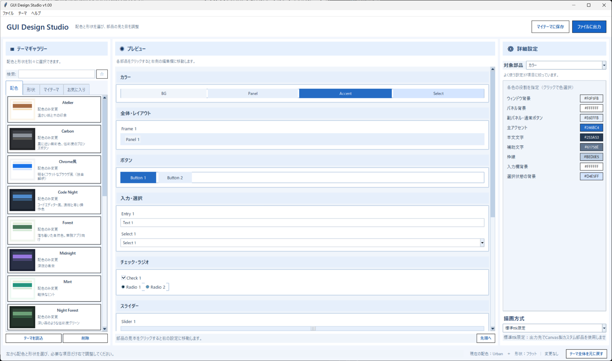

# GUI Design Studio v1.00

Python標準ライブラリだけで動く、**Tkinter／ttk向けのGUIテーマ作成ツール**です。色と部品の形状を選び、プレビューで確認しながら微調整して、JSONとPythonモジュールに出力できます。



*画面見本はWindows実機で取得したものです。環境により細部の表示が異なる場合があります。*

## 操作説明書

- [操作ガイド（GitHubでも読めるMarkdown版）](docs/操作ガイド.md)
- `使い方.html`：ZIPを展開した後、ブラウザで開くオフライン用の説明書です。

※ GitHub上で `.html` を直接クリックすると、ブラウザ表示ではなくソースコード表示になることがあります。GitHubでは上記Markdown版を参照してください。

## 特徴

- **20種類の配色プリセット**と**4種類の形状プリセット**を別々に選択
- ボタン・入力欄・チェックボックス・スライダー・スクロールバー・一覧などをまとめてプレビュー
- 配色9項目＋部品28項目、計37項目を右側から微調整
- マイテーマ保存、読み込み、削除、お気に入り登録
- JSON（設定値）とPython（テーマ適用処理）の両方を出力
- 標準ttk限定／ハイブリッド／デザイン優先の描画モードを選択
- 左のギャラリー、中央のプレビュー、右の詳細設定という3カラム構成

## 起動方法

Python 3.10以上を想定（追加の `pip install` は不要）。

```powershell
cd C:\Python\gui-design-studio
python .\gui_design_studio.py
```

## 基本操作

1. 「配色」から好きな色を選びます。
2. 「形状」からボタン等の見た目を選びます。
3. 中央プレビューで見た目を確認し、右側の「詳細設定」で必要な項目を調整します。
4. 再利用したい設定は「マイテーマに保存」で登録します。
5. 「ファイルに出力」で `design_theme.json` と `design_theme.py` を作成します。

## 出力したテーマをアプリで使う

```python
import tkinter as tk
from tkinter import ttk
from design_theme import apply_theme

root = tk.Tk()
apply_theme(root)
ttk.Button(root, text="実行").pack(padx=20, pady=20)
root.mainloop()
```

`design_theme.py` とアプリを同じフォルダへ配置します。既存のTkinterアプリを**自動で全面的にデザイン変換する機能ではありません**。各ウィジェットの種類やスタイル指定に応じて、アプリ側の調整が必要です。

### 実際の業務ツールへの適用例：File-Search

検索フォルダ2件、文字単位一致による順位付け、ファイルコピー、連番付与を備えるTkinterアプリ「File-Search」に、GUI Design Studioから出力した**Urban配色＋アウトライン形状（標準ttk限定）**を適用しました。

- デザイン設定は `design_theme.json` として保存
- 出力した `design_theme.py` でttkのスタイルを設定
- File-Search側でウィジェット構成や選択行の表示を調整
- 検索・コピー・設定保存などのアプリ処理は別途テスト

この連携例は、テーマの**出力と再利用**を示すものです。単一のJSONファイルを読み込むだけで既存GUIを完全変換できるという意味ではありません。元となったv0.9.2は利用者によるWindows実機の通常操作確認済みです。

詳しくは [連携例の技術メモ](docs/FileSearch連携例.md) を参照してください。

## 描画方式

| モード | 主な用途 |
| --- | --- |
| 標準ttk限定 | 従来型の業務ツール。Canvas製のカスタムボタン／スライダーは使用しない |
| ハイブリッド | 必要な部品だけ独自描画 |
| デザイン優先 | 部品の見た目を優先して独自描画を活用 |

**注意**：ttkの描画はOSとTkのテーマで変わる場合があります。標準ttk限定は性能改善やすべての環境での見た目の一致を保証しません。

Windowsではマイテーマを `%LOCALAPPDATA%\GUI-Design-Studio\themes` に保存します。古いテーマは基本的に読み込めるよう既存形式との互換性を維持しています。

## テスト

```powershell
python -m unittest discover -s tests -v
```

テスト環境は主にLinux仮想GUIです。Windows実機での表示は利用者が確認していますが、すべての組合せを実機検証したわけではありません。環境別の確認は継続してください。

## リポジトリ構成

```text
gui-design-studio/
  gui_design_studio.py   アプリ本体
  theme_data.py          テーマ定義
  theme_runtime.py       ttkスタイル／テーマ適用処理
  examples/              テーマ利用サンプル
  docs/                  画面見本・操作ガイド・技術メモ
  tests/                 自動テスト
  CHANGELOG.md           旧版の開発履歴
```

## 開発について

業務用PythonツールでのGUI再利用を目的として制作しています。仕様検討、実装、テストの補助に生成AIを利用する**AI駆動開発**の取り組みの一つです。出力内容を別アプリで試すなど、検証を重ねています。

**リリース状況**：v1.00 正式公開版。
