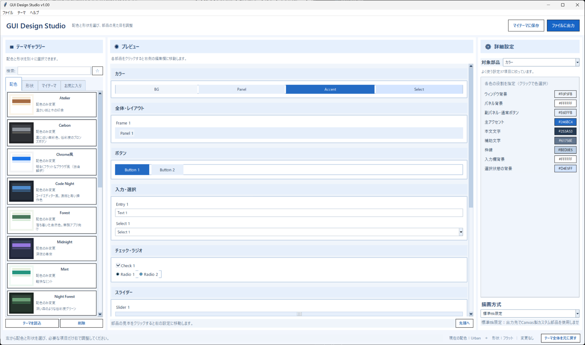

# GUI Design Studio 操作ガイド



## 1. 起動

Python 3.10以上で `python gui_design_studio.py` を実行します。追加ライブラリは不要です。

## 2. テーマの作成

1. 左の「配色」で好みの配色を選びます（20種類）。
2. 左の「形状」で部品の形状を選びます（4種類）。
3. 中央のプレビューで見た目を確認します。部品をクリックすると対応する詳細設定へ移動します。
4. 右の「詳細設定」で色や部品を細かく調整します。

## 3. マイテーマと出力

- **マイテーマに保存**：あとからStudioで再利用するデザインを名前付きで保存します。
- **ファイルに出力**：`design_theme.json`（設定データ）と `design_theme.py`（Pythonからの適用用モジュール）を書き出します。
- マイテーマの読み込み、削除、お気に入り登録にも対応します。

## 4. ほかのアプリに使う

出力した `design_theme.py` を利用先アプリと同じフォルダに配置します。

```python
import tkinter as tk
from tkinter import ttk
from design_theme import apply_theme

root = tk.Tk()
apply_theme(root)
ttk.Button(root, text="実行").pack(padx=20, pady=20)
root.mainloop()
```

既存のTkinterアプリの全ウィジェットが自動変換されるわけではありません。アプリ側で `ttk` 部品への変更やスタイルの指定が必要な場合があります。

## 5. 描画方式

| モード | 主な用途 |
| --- | --- |
| 標準ttk限定 | 標準ttk部品を中心に使用 |
| ハイブリッド | 必要な箇所で独自描画を使用 |
| デザイン優先 | 部品の見た目を優先 |

## 6. 詳細版

ダウンロードしたZIPを展開し、ルートの `使い方.html` をブラウザで開いてください。HTMLはローカル閲覧用です。
